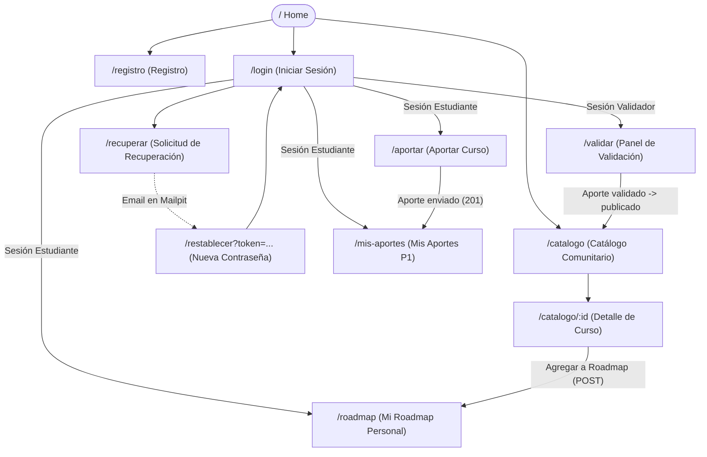

# APPFlow — Mapa del sitio y flujos de usuario — Aprende-Gratis

> **Qué es:** el esqueleto de navegación y experiencia de usuario. Sitemap (pantallas y rutas),
> ficha técnica por pantalla y flujos de usuario de punta a punta. Conecta el PRD (qué quiere el usuario)
> con el BackendSchema (qué API sostiene cada interacción).
> **Cuándo está bien:** se puede recorrer el producto completo en papel antes de escribir código React;
> cada pantalla sabe qué APIs consume y esas APIs existen en BackendSchema §3; no hay pantallas sin ruta
> ni rutas sin endpoint que las respalde.

---

## 1. Sitemap

---

## 2. Tabla de rutas de la aplicación

| Ruta | Nombre de pantalla | Requiere sesión | Rol requerido | Resumen de contenido y propósito |
|------|--------------------|-----------------|---------------|----------------------------------|
| `/` | Home | No | Público | Presentación del proyecto, propuesta de valor, accesos directos al catálogo y CTA para unirse. |
| `/catalogo` | Catálogo comunitario | No | Público | Listado paginado de cursos publicados con buscador por texto, filtro de categoría y cards. |
| `/catalogo/:id` | Detalle de curso | No | Público | Ficha completa del curso con metadatos, enlace externo oficial y botón para sumar a roadmap. |
| `/registro` | Registro de usuario | No | Anónimo (redirect si hay sesión) | Formulario de alta con nombre, email y contraseña. Rol asignado: `estudiante`. |
| `/login` | Inicio de sesión | No | Anónimo (redirect si hay sesión) | Formulario de acceso por email/password, protegido por rate limiting. |
| `/recuperar` | Solicitar recuperación | No | Anónimo | Pide email para enviar enlace temporal de reseteo. |
| `/restablecer` | Restablecer contraseña | No | Anónimo | Formulario para ingresar nueva contraseña usando el token recibido por email. |
| `/roadmap` | Mi roadmap personal | **Sí** | `estudiante` / `validador` | Lista priorizada y paginada de cursos guardados, con control de orden y estado de avance. |
| `/aportar` | Aportar curso | **Sí** | `estudiante` / `validador` | Formulario con los 12 metadatos del curso y declaración obligatoria de toma. |
| `/mis-aportes` | Mis aportes (P1) | **Sí** | `estudiante` / `validador` | Historial paginado de los cursos aportados por el usuario, con su estado y motivo de rechazo. |
| `/validar` | Panel de validación | **Sí** | `validador` | Listado de aportes pendientes (`en_revision`) para aprobar o rechazar con motivo. |

---

## 3. Fichas de pantalla

### 3.1 Pantalla: Home (`/`)
- **Objetivo del usuario:** Conocer de qué trata Aprende-Gratis, explorar cursos destacados y entender cómo sumarse a la comunidad.
- **Componentes principales:** Header con menú sándwich en mobile, Hero banner con llamado a la acción, barra de búsqueda rápida hacia el catálogo, sección explicativa (Cómo funciona: Aporta -> Validamos -> Estudia en tu Roadmap), Footer.
- **Estados:** `ok`.
- **APIs que consume:** Ninguna obligatoria para renderizar; opcionalmente `GET /api/v1/cursos?page_size=3` para mostrar los últimos 3 cursos destacados.
- **Navegación:** Enlaces a `/catalogo`, `/registro`, `/login`.

---

### 3.2 Pantalla: Catálogo Comunitario (`/catalogo`)
- **Objetivo del usuario:** Descubrir cursos gratuitos validados, buscar por tema o filtrar por área de conocimiento sin necesidad de estar registrado.
- **Componentes:**
  - Barra de búsqueda con debounce (`q`).
  - Selector de categoría (dropdown alimentado por lista cerrada).
  - Grid responsivo de cards (1 col en mobile, 2 en tablet, 3 en desktop).
  - Cada card muestra: título, categoría, tema, año, badges (certificado, examen, aval) y botón "Ver detalle".
  - Componente `Paginador` con botones "Anterior", números de página y "Siguiente".
  - Empty state ilustrado cuando no hay coincidencias ("No encontramos cursos con esos criterios. ¿Querés aportar uno?").
  - Skeleton loader mientras se realiza la consulta.
- **Estados:** `loading` (skeletons) · `ok` (cards + paginador) · `empty` (sin resultados + CTA aportar) · `error` (mensaje amigable + botón reintentar).
- **APIs que consume:**
  - `GET /api/v1/categorias` (para llenar el selector de filtros).
  - `GET /api/v1/cursos?page=N&page_size=20&categoria_id=X&q=Y` (BackendSchema §3.3).
- **Navegación:** Clic en una card navega a `/catalogo/:id`. Botón CTA en empty state lleva a `/aportar`.

---

### 3.3 Pantalla: Detalle de Curso (`/catalogo/:id`)
- **Objetivo del usuario:** Leer la ficha completa del curso y decidir si cursarlo o agregarlo a su roadmap.
- **Componentes:**
  - Título principal y categoría destacada.
  - Bloque de metadatos: tema, versión, año de edición, docentes o disertantes.
  - Tabla de atributos clave: ¿Tiene cuestionarios?, ¿Requiere examen?, ¿Extiende certificado?, Aval institucional (nombre si aplica), y si el aportante declaró haberlo tomado.
  - Botón primario: "Ir al sitio del curso" (enlace externo seguro con `rel="noopener noreferrer"` y `target="_blank"`).
  - Botón secundario: "Agregar a mi Roadmap" (si no está autenticado, redirige a `/login?redirect=/catalogo/:id`; si ya está en el roadmap, se muestra deshabilitado indicando "En tu roadmap").
- **Estados:** `loading` (spinner/skeleton) · `ok` · `error_404` ("Curso no encontrado o en revisión").
- **APIs que consume:**
  - `GET /api/v1/cursos/{id}` (BackendSchema §3.3).
  - `POST /api/v1/roadmap/items` con `{ "curso_id": id }` al presionar agregar.

---

### 3.4 Pantalla: Autenticación (`/registro`, `/login`, `/recuperar`, `/restablecer`)
- **Objetivo del usuario:** Crear cuenta, iniciar sesión con rate limiting defensivo o recuperar acceso si olvidó la contraseña.
- **Componentes:**
  - `/registro`: Inputs de Nombre, Email, Contraseña (con indicador de mínimo 8 caracteres), botón "Crear cuenta".
  - `/login`: Inputs de Email, Contraseña, botón "Iniciar sesión", enlace "¿Olvidaste tu contraseña?".
  - `/recuperar`: Input de Email, botón "Enviar instrucciones", alerta informativa neutral.
  - `/restablecer`: Input de Nueva contraseña y confirmación, botón "Actualizar contraseña".
- **Estados:** `idle` · `submitting` (botón con spinner y disabled) · `rate_limited` (alerta destacada si responde 429) · `field_errors` (validación inline debajo del input).
- **APIs que consume:**
  - `POST /api/v1/auth/registro`
  - `POST /api/v1/auth/login`
  - `POST /api/v1/auth/recuperar`
  - `POST /api/v1/auth/restablecer`

---

### 3.5 Pantalla: Mi Roadmap Personal (`/roadmap`)
- **Objetivo del usuario:** Organizar su propia ruta de estudio: ver sus cursos ordenados por prioridad y actualizar su avance a medida que aprende.
- **Componentes:**
  - Resumen visual de avance: contador de cursos (Pendientes / En curso / Completados).
  - Lista paginada de ítems de roadmap.
  - Cada fila o tarjeta contiene:
    - Indicador de posición `#1`, `#2`, etc.
    - Título del curso y enlace para abrir su detalle.
    - Selector desplegable de estado (`pendiente`, `en_curso`, `completado`) con colores semánticos.
    - Controles de orden: flechas "Subir" / "Bajar" de posición.
    - Botón de acción: "Quitar de mi roadmap" (con diálogo de confirmación).
  - Empty state: "Todavía no agregaste cursos a tu roadmap. Explorá el catálogo comunitario para empezar".
- **Estados:** `loading` · `ok` · `empty` · `updating` (optimistic update con rollback si falla la red).
- **APIs que consume:**
  - `GET /api/v1/roadmap?page=N&page_size=20` (BackendSchema §3.5).
  - `PATCH /api/v1/roadmap/items/{id}` (para cambiar estado u orden).
  - `DELETE /api/v1/roadmap/items/{id}` (para quitar el ítem).

---

### 3.6 Pantalla: Aportar Curso (`/aportar`)
- **Objetivo del usuario:** Cargar un curso gratuito para que pase a revisión y forme parte del bien común.
- **Componentes:** Formulario estructurado en secciones:
  1. *Identificación:* URL del curso (con validación de protocolo `https://`), Título, Categoría (select obligatorio), Tema.
  2. *Edición y Docencia:* Versión del contenido, Año de edición (input number con límites 1990..año actual), Docentes o disertantes (texto libre).
  3. *Características:* Checkboxes para "¿Tiene cuestionarios?", "¿Requiere examen?", "¿Extiende certificado?", "¿Cuenta con aval de organización?". Si este último se activa, se despliega un campo de texto para el nombre de la organización.
  4. *Declaración:* Radio buttons o checkbox explícito "¿Tomaste o estás tomando este curso?" (Sí / No) — obligatorio (BR-002).
  5. Botón de envío "Enviar aporte para revisión".
- **Estados:** `idle` · `submitting` · `validation_error` · `duplicate_error` (aviso de URL repetida 409).
- **APIs que consume:**
  - `GET /api/v1/categorias` (para opciones del selector).
  - `POST /api/v1/aportes` (BackendSchema §3.4).
- **Navegación:** Al completar con éxito, muestra un toast de éxito y redirige a `/mis-aportes`.

---

### 3.7 Pantalla: Mis Aportes (`/mis-aportes`) — Prioridad P1
- **Objetivo del usuario:** Conocer el estado de los aportes realizados y revisar motivos en caso de rechazo.
- **Componentes:**
  - Tabla responsive o lista de tarjetas con los cursos aportados por el usuario actual.
  - Columnas: Título, URL, Fecha de envío, Badge de estado (`En revisión` en amarillo, `Publicado` en verde, `Rechazado` en rojo).
  - Si el estado es `Rechazado`, muestra un botón "Ver motivo" que abre un modal con el texto que escribió el validador (BR-007).
  - Componente `Paginador`.
- **APIs que consume:**
  - `GET /api/v1/aportes/mios?page=N&page_size=20` (BackendSchema §3.4).

---

### 3.8 Pantalla: Panel de Validación (`/validar`) — Rol Validador
- **Objetivo del usuario:** Revisar cursos pendientes de moderación para garantizar que cumplan las reglas (enlace activo, datos verídicos y contenido gratuito).
- **Componentes:**
  - Lista paginada de aportes en estado `en_revision`, ordenados del más antiguo al más nuevo.
  - Vista expandida de cada aporte con todos sus metadatos declarados y botón "Abrir enlace en pestaña nueva" para verificar el link.
  - Acciones por curso:
    - Botón "Aprobar": confirmación rápida → pasa a `publicado`.
    - Botón "Rechazar": abre ventana modal donde el validador debe ingresar obligatoriamente el motivo del rechazo antes de confirmar.
- **Estados:** `loading` · `ok` · `empty` ("No hay aportes pendientes de revisión. ¡El catálogo está al día!").
- **APIs que consume:**
  - `GET /api/v1/aportes/pendientes?page=N&page_size=20`.
  - `POST /api/v1/aportes/{id}/validar` con `{ "aprobado": true }` o `{ "aprobado": false, "motivo": "..." }`.

---

## 4. Flujos de usuario de punta a punta

### Flujo 1 — Descubrir un curso y sumarlo al Roadmap personal (P0)

1. **Entrada:** Un usuario ingresa a `/catalogo` desde el celular.
2. **Búsqueda:** Escribe "FastAPI" en el buscador y selecciona la categoría "Desarrollo Web".
3. **Listado:** La grilla se actualiza en tiempo real mostrando los resultados paginados con badges informativos.
4. **Inspección:** El usuario presiona la card de "FastAPI Profesional"; la app navega a `/catalogo/15`.
5. **Decisión:** Revisa que tiene certificado y aval institucional, y hace clic en "Agregar a mi roadmap".
6. **Bifurcación:**
   - *Si no tenía sesión:* La app lo redirige a `/login?redirect=/catalogo/15`. Tras loguearse exitosamente, regresa al detalle y ejecuta la acción.
   - *Si ya tenía sesión:* Se despacha `POST /api/v1/roadmap/items`.
7. **Confirmación:** La UI muestra un toast "¡Agregado a tu roadmap!" y el botón cambia a "En tu roadmap (Ver roadmap)".
8. **Consulta:** El usuario entra a `/roadmap` y encuentra el curso al final de su lista con estado `pendiente`.

---

### Flujo 2 — Aportar un curso comunitario (P0)

1. **Inicio:** Un usuario autenticado hace clic en "Aportar curso" en el menú de navegación.
2. **Carga de formulario:** Ingresa a `/aportar`. El selector de categoría se carga automáticamente desde `/api/v1/categorias`.
3. **Completado:** Completa los campos obligatorios. Al marcar "¿Cuenta con aval de organización?", se despliega el campo para indicar el nombre de la institución. En la declaración de toma, selecciona "Sí, completé este curso".
4. **Validación del cliente:** Si intenta enviar una URL sin `http://` o deja el año vacío, los mensajes de error se muestran de forma inline junto a cada control sin borrar el resto de datos.
5. **Envío:** Al presionar "Enviar aporte", se despacha `POST /api/v1/aportes`.
6. **Manejo de respuestas:**
   - *Éxito (201):* Se muestra una notificación "Aporte recibido con éxito. Será revisado por un validador antes de publicarse" y se redirige a `/mis-aportes`.
   - *Duplicado (409):* El backend responde con código `URL_DUPLICADA`; la pantalla muestra una alerta en rojo: "Este curso ya fue registrado previamente en la plataforma".

---

### Flujo 3 — Ciclo de validación y moderación (P0)

1. **Ingreso:** Un usuario con rol `validador` inicia sesión y entra a `/validar`.
2. **Revisión:** Observa el listado de aportes `en_revision`. Abre el enlace externo del curso en una pestaña secundaria para verificar que no sea un link roto y que efectivamente no requiera pago.
3. **Resolución A (Aprobación):** El curso es correcto. Presiona "Aprobar". La app despacha `POST /api/v1/aportes/15/validar` con `{ "aprobado": true }`. El curso desaparece de pendientes y pasa inmediatamente a estar visible en `/catalogo`.
4. **Resolución B (Rechazo):** El enlace requiere suscripción paga. Presiona "Rechazar". Se abre un modal solicitando el motivo. Escribe: *"El curso requiere suscripción mensual paga para acceder al contenido"* y confirma. La app despacha `POST /api/v1/aportes/15/validar` con `{ "aprobado": false, "motivo": "..." }`.
5. **Impacto:** El curso no se publicará. El autor original podrá ver dicho motivo desde su pantalla `/mis-aportes`.

---

### Flujo 4 — Recuperación de contraseña segura con Mailpit (P0)

1. **Olvido:** En `/login`, el usuario presiona "¿Olvidaste tu contraseña?" y navega a `/recuperar`.
2. **Solicitud:** Ingresa su email registrado y presiona "Enviar enlace".
3. **Respuesta neutral:** La pantalla muestra el mensaje estándar: *"Si el email ingresado se encuentra registrado, recibirás un enlace en tu casilla de correo"*, protegiendo la privacidad de los usuarios contra enumeración de cuentas.
4. **Emisión y recepción:** En segundo plano, el backend genera un token criptográfico seguro de 32 bytes, guarda su hash SHA-256 en la base con expiración de 30 minutos, y envía un correo vía SMTP local a Mailpit.
5. **Apertura:** El alumno/docente abre la bandeja web de Mailpit (`http://localhost:8025`), visualiza el email recibido y hace clic en el enlace provisto (`http://localhost:5173/restablecer?token=XXXX`).
6. **Actualización:** La pantalla `/restablecer` valida la presencia del token en la URL. El usuario ingresa su nueva contraseña (mínimo 8 caracteres).
7. **Confirmación:** Al presionar "Actualizar", se envía `POST /api/v1/auth/restablecer`. El backend verifica el hash, actualiza la clave cifrada con bcrypt y marca el token como consumido (`usado_en = now()`).
8. **Final:** La app redirige al usuario a `/login` con un mensaje de éxito para que inicie sesión con su nueva clave.

---

## 5. Manejo de estados globales de la aplicación

| Situación | Comportamiento del Frontend |
|-----------|-----------------------------|
| **Navegación a ruta protegida sin sesión** (`/roadmap`, `/aportar`, `/mis-aportes`) | Redirección automática inmediata hacia `/login?redirect=<ruta_actual>`. Al completar el login, el usuario es devuelto a la pantalla que intentó abrir originalmente. |
| **Acceso a `/validar` con rol `estudiante`** | Redirección a `/` con un toast de alerta: *"No tenés permisos de validador para acceder a esa sección"*. |
| **Token JWT vencido durante el uso (401 en cualquier request)** | Se borra el token de `localStorage`, se resetea el estado global de usuario en React y se redirige a `/login` con el mensaje: *"Tu sesión expiró por seguridad. Por favor, ingresá nuevamente"*. |
| **Límite de peticiones alcanzado (429 Rate Limit)** | Se captura en el interceptor HTTP global y se muestra un banner de advertencia con cuenta regresiva: *"Demasiados intentos seguidos. Por favor, aguardá 1 minuto antes de reintentar"*. |
| **Falla total de red o backend caído** | Toast persistente en la parte superior: *"No pudimos conectar con el servidor. Verificá tu conexión o reintentá en unos segundos"* con botón de reintento manual. |
