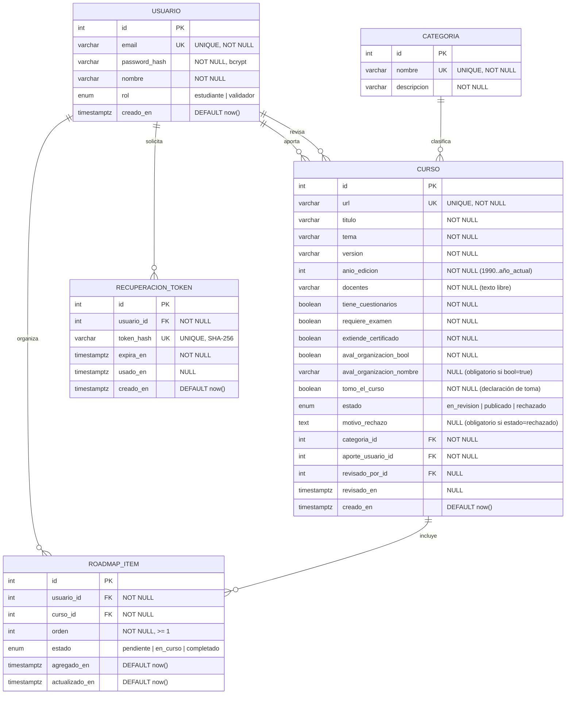

# BackendSchema — Esquema de base de datos y APIs — Aprende-Gratis

> **Qué es:** el contrato del backend: modelo de datos en PostgreSQL 18.6 + superficie de API REST.
> Es lo que implementa las decisiones del TRD y lo que consume la interfaz definida en APPFlow y UX-UI.
> **Cuándo está bien:** con este documento se puede crear la base de datos y escribir los tests
> de integración sin dudas de diseño; todo endpoint del APPFlow existe acá con sus respuestas y errores;
> los estados del curso y las restricciones de negocio están formalizados.

---

## 1. Modelo de datos

### 1.1 Diagrama entidad-relación (Mermaid)



---

### 1.2 Tablas y restricciones en PostgreSQL 18.6

#### Tabla `usuarios`
Representa a los miembros de la plataforma (estudiantes y moderadores/validadores).

| Columna | Tipo SQL | Constraints | Descripción |
|---------|----------|-------------|-------------|
| `id` | `SERIAL` | `PRIMARY KEY` | Identificador único autoincremental |
| `email` | `VARCHAR(255)` | `NOT NULL, UNIQUE` | Email normalizado en minúsculas, usado para login |
| `password_hash` | `VARCHAR(255)` | `NOT NULL` | Hash bcrypt (mínimo exigido por SPEC) |
| `nombre` | `VARCHAR(100)` | `NOT NULL` | Nombre para mostrar en UI |
| `rol` | `VARCHAR(20)` | `NOT NULL, DEFAULT 'estudiante'` | Valores válidos: `'estudiante'`, `'validador'` |
| `creado_en` | `TIMESTAMPTZ` | `NOT NULL, DEFAULT now()` | Fecha de registro en UTC |

- **Índices:**
  - `idx_usuarios_email`: `btree(email)` — soporte para login y validación rápida de duplicados (RF-001).

---

#### Tabla `categorias`
Lista cerrada precargada mediante seed inicial (SPEC §8 #6 y TRD TD-011).

| Columna | Tipo SQL | Constraints | Descripción |
|---------|----------|-------------|-------------|
| `id` | `SERIAL` | `PRIMARY KEY` | Identificador |
| `nombre` | `VARCHAR(60)` | `NOT NULL, UNIQUE` | Nombre visible (ej. "Desarrollo Web", "Datos e IA") |
| `descripcion` | `VARCHAR(255)` | `NOT NULL` | Breve guía sobre qué abarca la categoría |

---

#### Tabla `cursos`
Almacena todos los cursos aportados por la comunidad, sus metadatos obligatorios y su estado de validación.

| Columna | Tipo SQL | Constraints | Descripción |
|---------|----------|-------------|-------------|
| `id` | `SERIAL` | `PRIMARY KEY` | Identificador |
| `url` | `VARCHAR(2048)` | `NOT NULL, UNIQUE` | Enlace activo al curso externo (BR-004) |
| `titulo` | `VARCHAR(200)` | `NOT NULL` | Título del curso |
| `tema` | `VARCHAR(150)` | `NOT NULL` | Tema específico o tecnología (ej. "FastAPI REST") |
| `version` | `VARCHAR(50)` | `NOT NULL` | Versión del contenido (ej. "v2.0", "2026") |
| `anio_edicion` | `INTEGER` | `NOT NULL` | Año de edición (CHECK `anio_edicion >= 1990 AND anio_edicion <= EXTRACT(YEAR FROM now())`) |
| `docentes` | `VARCHAR(300)` | `NOT NULL` | Docentes o disertantes en texto libre (SPEC §8 #9) |
| `tiene_cuestionarios` | `BOOLEAN` | `NOT NULL` | Flag de cuestionarios |
| `requiere_examen` | `BOOLEAN` | `NOT NULL` | Flag de examen |
| `extiende_certificado`| `BOOLEAN` | `NOT NULL` | Flag de certificado |
| `aval_organizacion_bool` | `BOOLEAN` | `NOT NULL` | Indica si cuenta con aval institucional |
| `aval_organizacion_nombre` | `VARCHAR(150)` | `NULL` | Nombre de la entidad (obligatorio si bool = true) |
| `tomo_el_curso` | `BOOLEAN` | `NOT NULL` | Declaración de toma obligatoria (BR-002) |
| `estado` | `VARCHAR(20)` | `NOT NULL, DEFAULT 'en_revision'` | Valores: `'en_revision'`, `'publicado'`, `'rechazado'` |
| `motivo_rechazo` | `TEXT` | `NULL` | Motivo escrito por el validador si es rechazado (BR-007) |
| `categoria_id` | `INTEGER` | `NOT NULL, FK -> categorias(id)` | Categoría elegida de la lista cerrada |
| `aporte_usuario_id` | `INTEGER` | `NOT NULL, FK -> usuarios(id)` | Usuario que aportó el curso |
| `revisado_por_id` | `INTEGER` | `NULL, FK -> usuarios(id)` | Usuario validador que dictaminó |
| `revisado_en` | `TIMESTAMPTZ` | `NULL` | Fecha/hora del dictamen |
| `creado_en` | `TIMESTAMPTZ` | `NOT NULL, DEFAULT now()` | Fecha de aporte en UTC |

- **Índices:**
  - `idx_cursos_estado_categoria`: `btree(estado, categoria_id)` — acelera el catálogo filtrado (RF-004).
  - `idx_cursos_aporte_usuario`: `btree(aporte_usuario_id)` — acelera "Mis aportes" (US-007).
  - `idx_cursos_url`: `btree(url)` — soporte para unicidad estricta.

---

#### Tabla `roadmap_items`
Tabla intermedia que modela el roadmap personal de cada usuario (TRD TD-004 y PRD BR-003, BR-006).

| Columna | Tipo SQL | Constraints | Descripción |
|---------|----------|-------------|-------------|
| `id` | `SERIAL` | `PRIMARY KEY` | Identificador del ítem |
| `usuario_id` | `INTEGER` | `NOT NULL, FK -> usuarios(id) ON DELETE CASCADE` | Dueño del roadmap |
| `curso_id` | `INTEGER` | `NOT NULL, FK -> cursos(id) ON DELETE RESTRICT` | Curso publicado asociado |
| `orden` | `INTEGER` | `NOT NULL, CHECK (orden >= 1)` | Posición prioritaria en el roadmap del usuario |
| `estado` | `VARCHAR(20)` | `NOT NULL, DEFAULT 'pendiente'` | Valores: `'pendiente'`, `'en_curso'`, `'completado'` |
| `agregado_en` | `TIMESTAMPTZ` | `NOT NULL, DEFAULT now()` | Fecha de inclusión |
| `actualizado_en` | `TIMESTAMPTZ` | `NOT NULL, DEFAULT now()` | Último cambio de estado u orden |

- **Restricciones adicionales:**
  - `UNIQUE (usuario_id, curso_id)` — un mismo curso no puede duplicarse en el roadmap del usuario (BR-006).
- **Índices:**
  - `idx_roadmap_usuario_orden`: `btree(usuario_id, orden)` — listado ordenado y paginado rápido (US-004).

---

#### Tabla `recuperacion_tokens`
Tokens temporales de un solo uso para recuperación de contraseña (TRD TD-012, US-006).

| Columna | Tipo SQL | Constraints | Descripción |
|---------|----------|-------------|-------------|
| `id` | `SERIAL` | `PRIMARY KEY` | Identificador |
| `usuario_id` | `INTEGER` | `NOT NULL, FK -> usuarios(id) ON DELETE CASCADE` | Usuario solicitante |
| `token_hash` | `VARCHAR(64)` | `NOT NULL, UNIQUE` | Hash SHA-256 del token opaco (seguridad defensiva) |
| `expira_en` | `TIMESTAMPTZ` | `NOT NULL` | Vencimiento (30 min desde emisión) |
| `usado_en` | `TIMESTAMPTZ` | `NULL` | Fecha en que fue consumido (un solo uso) |
| `creado_en` | `TIMESTAMPTZ` | `NOT NULL, DEFAULT now()` | Fecha de emisión |

---

## 2. Ciclo de vida y estados del curso

```mermaid
stateDiagram-v2
    [*] --> en_revision : Aporte enviado por usuario autenticado (POST /api/v1/aportes)
    en_revision --> publicado : Validador aprueba (POST /api/v1/aportes/{id}/validar con aprobado=true)
    en_revision --> rechazado : Validador rechaza con motivo obligatorio (POST ... con aprobado=false)
    publicado --> [*] : Visible en catálogo público y disponible para roadmaps
    rechazado --> [*] : Visible solo por el autor en "Mis aportes"; no editable
```



### Matriz de visibilidad y permisos por estado

| Estado | Quién lo ve | Acciones permitidas |
|--------|-------------|---------------------|
| `en_revision` | Autor del aporte (en "Mis aportes") y usuarios con rol `validador` (en panel `/validar`) | Validador: aprobar o rechazar con motivo. Autor: solo lectura de estado. |
| `publicado` | Todo el público (visitantes anónimos y registrados en `/catalogo`) | Estudiantes: agregar a roadmap personal. Público: ver detalle y abrir enlace. |
| `rechazado` | Autor del aporte y usuarios con rol `validador` | Autor: consultar motivo de rechazo. (No editable; puede crear un nuevo aporte). |

---

## 3. Especificación de la API REST

### 3.1 Convenciones generales

- **Prefijo:** `/api/v1`
- **Autenticación:** Header estándar `Authorization: Bearer <token_jwt>` (TRD TD-001).
- **Formato de Paginación:** Query params `page` (default 1) y `page_size` (default 20, max 50).
  ```json
  {
    "items": [],
    "total": 45,
    "page": 1,
    "page_size": 20
  }
  ```
- **Envelope de error unificado (TRD TD-003):**
  ```json
  {
    "error": {
      "code": "NOMBRE_DEL_ERROR",
      "message": "Mensaje en lenguaje claro para el usuario",
      "details": null
    }
  }
  ```
  Para errores de validación (422), `details` es un array `[ { "campo": "...", "mensaje": "..." } ]`.

---

### 3.2 Módulo Identidad (`/api/v1/auth`)

| Método | Endpoint | Auth | Rate Limit | Descripción |
|--------|----------|------|------------|-------------|
| `POST` | `/api/v1/auth/registro` | Pública | — | Registro de nuevo usuario (rol `estudiante`) |
| `POST` | `/api/v1/auth/login` | Pública | 5/min por IP | Login con credenciales, emite token JWT |
| `GET` | `/api/v1/auth/me` | Bearer | — | Obtiene los datos y rol del usuario autenticado |
| `POST` | `/api/v1/auth/recuperar` | Pública | 3/min por IP | Solicita enlace de recuperación por email (Mailpit) |
| `POST` | `/api/v1/auth/restablecer` | Pública | — | Define nueva contraseña con token temporal válido |

#### Detalle de payloads:

- **`POST /api/v1/auth/registro`**
  - *Request Body:*
    ```json
    {
      "email": "lucia@estudiante.utn.edu.ar",
      "password": "Password123",
      "nombre": "Lucía Gómez"
    }
    ```
  - *Respuestas:*
    - `201 Created`: `{ "id": 1, "email": "lucia@estudiante.utn.edu.ar", "nombre": "Lucía Gómez", "rol": "estudiante" }`
    - `409 Conflict`: `code: "EMAIL_DUPLICADO"` ("Ese email ya está registrado.")
    - `422 Unprocessable Entity`: Error de formato de email o password < 8 caracteres.

- **`POST /api/v1/auth/login`**
  - *Request Body:* `{ "email": "lucia@estudiante.utn.edu.ar", "password": "Password123" }`
  - *Respuestas:*
    - `200 OK`: `{ "access_token": "eyJhbGciOi...", "token_type": "bearer", "usuario": { "id": 1, "nombre": "Lucía Gómez", "email": "...", "rol": "estudiante" } }`
    - `401 Unauthorized`: `code: "CREDENCIALES_INVALIDAS"` ("Email o contraseña incorrectos.")
    - `429 Too Many Requests`: `code: "RATE_LIMIT_EXCEDED"` ("Demasiados intentos. Probá en un minuto.")

- **`POST /api/v1/auth/recuperar`**
  - *Request Body:* `{ "email": "lucia@estudiante.utn.edu.ar" }`
  - *Respuestas:*
    - `200 OK`: `{ "mensaje": "Si el email está registrado, te enviamos un enlace de recuperación." }` *(No revela si el email existe)*
    - `429 Too Many Requests`: Rate limit superado.

- **`POST /api/v1/auth/restablecer`**
  - *Request Body:* `{ "token": "a1b2c3d4...", "nueva_password": "NuevaPassword123" }`
  - *Respuestas:*
    - `200 OK`: `{ "mensaje": "Contraseña actualizada exitosamente." }`
    - `400 Bad Request`: `code: "TOKEN_INVALIDO_O_EXPIRADO"` ("El enlace no es válido o ha vencido.")

---

### 3.3 Módulo Catálogo (`/api/v1/cursos` y `/api/v1/categorias`)

| Método | Endpoint | Auth | Descripción |
|--------|----------|------|-------------|
| `GET` | `/api/v1/categorias` | Pública | Lista completa de categorías cerradas para filtros y formulario |
| `GET` | `/api/v1/cursos` | Pública | Listado paginado de cursos en estado `publicado` |
| `GET` | `/api/v1/cursos/{id}` | Pública | Detalle completo de un curso publicado |

#### Detalle de payloads:

- **`GET /api/v1/cursos?page=1&page_size=20&categoria_id=2&q=python`**
  - *Respuestas:*
    - `200 OK`:
      ```json
      {
        "items": [
          {
            "id": 10,
            "titulo": "Python para Principiantes",
            "tema": "Fundamentos de Python y POO",
            "version": "2026",
            "anio_edicion": 2026,
            "docentes": "Ana Pérez",
            "categoria": { "id": 2, "nombre": "Desarrollo Web" },
            "tiene_cuestionarios": true,
            "requiere_examen": false,
            "extiende_certificado": true,
            "aval_organizacion": "Fundación Código Abierto",
            "tomo_el_curso": true,
            "url": "https://plataforma.org/curso-python"
          }
        ],
        "total": 1,
        "page": 1,
        "page_size": 20
      }
      ```

- **`GET /api/v1/cursos/{id}`**
  - *Respuestas:*
    - `200 OK`: Objeto curso completo con datos del aporte.
    - `404 Not Found`: `code: "CURSO_NO_ENCONTRADO"` (si no existe o su estado no es `publicado`).

---

### 3.4 Módulo Aportes y Validación (`/api/v1/aportes`)

| Método | Endpoint | Auth | Rol | Descripción |
|--------|----------|------|-----|-------------|
| `POST` | `/api/v1/aportes` | Bearer | Cualquiera | Aporta un curso nuevo; ingresa en `en_revision` |
| `GET` | `/api/v1/aportes/mios` | Bearer | Cualquiera | Lista paginada de aportes realizados por el usuario |
| `GET` | `/api/v1/aportes/pendientes`| Bearer | `validador` | Lista paginada de cursos en espera de revisión |
| `POST` | `/api/v1/aportes/{id}/validar` | Bearer | `validador` | Dictamina un aporte (aprobar o rechazar con motivo) |

#### Detalle de payloads:

- **`POST /api/v1/aportes`**
  - *Request Body:*
    ```json
    {
      "url": "https://freecodecamp.org/learn/fastapi",
      "categoria_id": 1,
      "titulo": "FastAPI Profesional y Moderno",
      "tema": "Desarrollo de APIs REST Asíncronas",
      "version": "v1.0",
      "anio_edicion": 2026,
      "docentes": "Carlos González, María Vega",
      "tiene_cuestionarios": true,
      "requiere_examen": false,
      "extiende_certificado": true,
      "aval_organizacion_bool": true,
      "aval_organizacion_nombre": "FreeCodeCamp",
      "tomo_el_curso": true
    }
    ```
  - *Respuestas:*
    - `201 Created`: `{ "id": 15, "estado": "en_revision", "mensaje": "Aporte recibido. Pendiente de validación." }`
    - `409 Conflict`: `code: "URL_DUPLICADA"` ("Este curso ya fue aportado.")
    - `422 Unprocessable Entity`: Error de validación (ej. URL mal formada, falta aval si bool=true).

- **`GET /api/v1/aportes/mios?page=1&page_size=20`**
  - *Respuestas:*
    - `200 OK`: Listado paginado que incluye `{ id, titulo, url, estado, motivo_rechazo, creado_en }`.

- **`GET /api/v1/aportes/pendientes?page=1&page_size=20`**
  - *Respuestas:*
    - `200 OK`: Listado paginado de cursos en `en_revision` ordenados por `creado_en ASC`.
    - `403 Forbidden`: Si el usuario no tiene rol `validador`.

- **`POST /api/v1/aportes/{id}/validar`**
  - *Request Body (Aprobación):*
    ```json
    {
      "aprobado": true
    }
    ```
  - *Request Body (Rechazo):*
    ```json
    {
      "aprobado": false,
      "motivo": "El enlace web no se encuentra activo o el curso es de pago."
    }
    ```
  - *Respuestas:*
    - `200 OK`: `{ "id": 15, "estado": "publicado" }` (o `"rechazado"`).
    - `400 Bad Request`: `code: "MOTIVO_REQUERIDO"` si `aprobado: false` y falta el motivo.
    - `403 Forbidden`: Usuario sin rol `validador`.
    - `404 Not Found`: Aporte inexistente o no está en `en_revision`.

---

### 3.5 Módulo Roadmap Personal (`/api/v1/roadmap`)

| Método | Endpoint | Auth | Descripción |
|--------|----------|------|-------------|
| `GET` | `/api/v1/roadmap` | Bearer | Lista paginada del roadmap del usuario, ordenada por `orden ASC` |
| `POST` | `/api/v1/roadmap/items` | Bearer | Agrega un curso publicado al final del roadmap personal |
| `PATCH`| `/api/v1/roadmap/items/{id}` | Bearer | Modifica el estado (`pendiente`/`en_curso`/`completado`) u orden |
| `DELETE`| `/api/v1/roadmap/items/{id}`| Bearer | Quita un curso del roadmap personal |

#### Detalle de payloads:

- **`GET /api/v1/roadmap?page=1&page_size=20`**
  - *Respuestas:*
    - `200 OK`:
      ```json
      {
        "items": [
          {
            "id": 1,
            "orden": 1,
            "estado": "en_curso",
            "agregado_en": "2026-10-23T20:00:00Z",
            "curso": {
              "id": 10,
              "titulo": "Python para Principiantes",
              "tema": "Fundamentos de Python",
              "categoria": "Desarrollo Web",
              "url": "https://plataforma.org/curso-python",
              "extiende_certificado": true
            }
          }
        ],
        "total": 1,
        "page": 1,
        "page_size": 20
      }
      ```

- **`POST /api/v1/roadmap/items`**
  - *Request Body:* `{ "curso_id": 10 }`
  - *Comportamiento:* Asigna automáticamente `orden = (max(orden) del usuario) + 1` y `estado = "pendiente"`.
  - *Respuestas:*
    - `201 Created`: Objeto ítem de roadmap creado.
    - `400 Bad Request`: `code: "CURSO_NO_PUBLICADO"` (no se pueden agregar cursos no publicados).
    - `409 Conflict`: `code: "CURSO_YA_EN_ROADMAP"` ("Este curso ya forma parte de tu roadmap.")

- **`PATCH /api/v1/roadmap/items/{id}`**
  - *Request Body:* `{ "estado": "completado", "orden": 2 }` (campos opcionales)
  - *Respuestas:*
    - `200 OK`: Objeto ítem actualizado.
    - `404 Not Found`: Ítem inexistente o pertenece a otro usuario (BR-003).

- **`DELETE /api/v1/roadmap/items/{id}`**
  - *Respuestas:*
    - `204 No Content`: Eliminado exitosamente.
    - `404 Not Found`: Ítem inexistente o de otro usuario.

---

## 4. Decisiones de diseño del esquema

| Decisión | Alternativas | Elección y Justificación |
|----------|--------------|--------------------------|
| **Categorías como tabla vs. Enum Postgres** | `ENUM('Desarrollo Web', ...)` | **Tabla relacional con FK**: Permite agregar nuevas categorías mediante seed o configuración sin alterar tipos DDL de base de datos (`ALTER TYPE`). |
| **Docentes como texto libre vs. tabla `docentes` M:N** | Tabla de docentes + tabla intermedia curso_docente | **Texto libre (`VARCHAR(300)`)**: La consigna pide almacenar docentes/disertantes. Crear un modelo relacional M:N obligaría a pantallas de autocompletado y gestión de profesores ajenas al foco del MVP. |
| **Aval de organización** | Solo texto / Solo booleano | **Booleano + Nombre condicional**: Modela fielmente la pregunta "¿lo avala una organización?" y registra la institución solo si corresponde. |
| **Roadmap como tabla intermedia independiente** | Array de IDs `int[]` en la tabla usuario | **Tabla `roadmap_items` con constraints**: Garantiza integridad referencial (`ON DELETE RESTRICT`), evita duplicados con `UNIQUE(usuario_id, curso_id)` y almacena orden y avance individual. |
| **Token de recuperación hash en base vs. JWT** | Token JWT sin estado en URL | **Token aleatorio con hash SHA-256 en BD**: Permite invalidación instantánea una vez usado (`usado_en`), garantizando el criterio de aceptación de token de un solo uso (US-006). |
