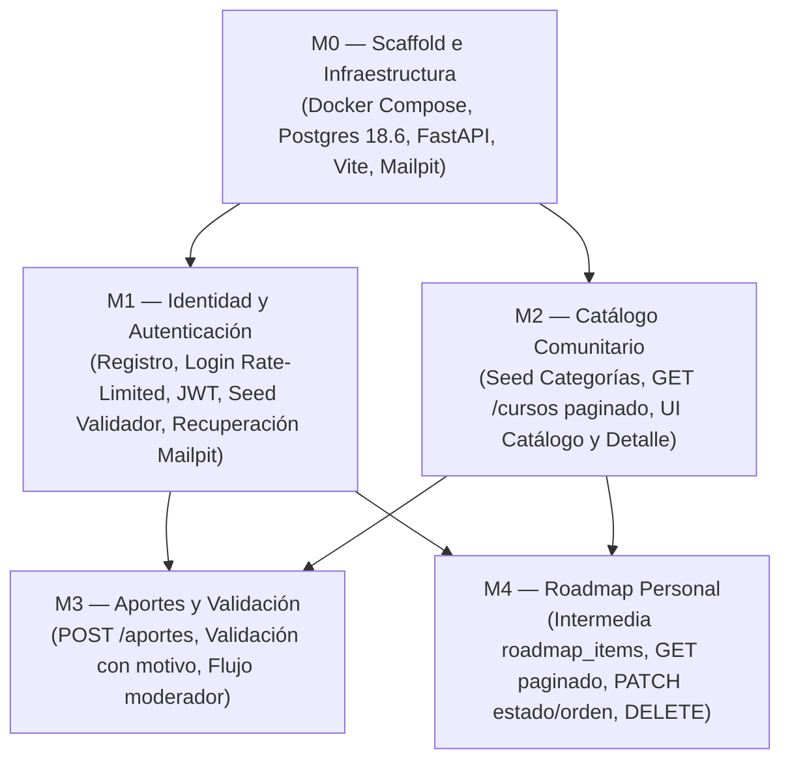

# Implementation Plan — Aprende-Gratis

> **Qué es:** el orden de construcción cronológico y modular. Módulos, dependencias, tareas con
> su criterio verificable de "Hecho cuando..." y estimaciones de esfuerzo. Es el mapa de ruta que se
> ejecuta en la Instancia B, tarea por tarea, rama por rama según GitHub Flow.
> **Cuándo está bien:** cada tarea tiene un "hecho" inequívoco (se prueba con un comando o una acción
> en la UI sin dudas); el orden respeta dependencias técnicas reales; el alcance del MVP está cerrado.

---

## 1. MVP — Qué es P0 (Criterio de éxito de la Instancia B)

El MVP de Aprende-Gratis está completo y verificado cuando en una máquina limpia con Docker Desktop:
```bash
git clone <tu-repo>
cd roadmap-cursos
docker compose up -d
```
Todos los contenedores levantan con éxito (`postgres`, `backend`, `frontend`, `mailpit`) y se recorren de punta a punta desde el navegador sin errores en consola las siguientes historias de usuario **P0** del PRD:

- **US-001 (Catálogo Comunitario):** Navegar `/catalogo`, filtrar por categoría y por texto `q`, ver paginación funcional y entrar a `/catalogo/:id`.
- **US-002 (Autenticación y Seguridad):** Registrarse en `/registro`, iniciar sesión en `/login` obteniendo JWT, y verificar que al 6.º intento fallido se activa el bloqueo por rate limiting (429).
- **US-003 (Aporte de Cursos):** Ingresar a `/aportar`, cargar un curso con sus metadatos obligatorios y declaración de toma, verificando que quede en estado `en_revision` y que rechace URLs duplicadas (409).
- **US-004 (Roadmap Personal):** Desde el catálogo, sumar un curso publicado al roadmap personal, entrar a `/roadmap`, cambiar su estado (`pendiente` -> `en_curso` -> `completado`) y reordenarlo.
- **US-005 (Validación y Moderación):** Iniciar sesión con la cuenta de validador (seed), entrar a `/validar`, aprobar un aporte para que pase al catálogo público y rechazar otro ingresando un motivo obligatorio.
- **US-006 (Recuperación de Contraseña):** Solicitar restablecimiento en `/recuperar`, abrir la bandeja web de Mailpit (`http://localhost:8025`), seguir el enlace recibido y actualizar la clave para loguearse con la nueva contraseña.

*(La historia US-007 "Mis aportes" es prioridad P1; se implementa una vez cerrado el circuito P0).*

---

## 2. Grafo de módulos y dependencias



---

## 3. Detalle de tareas por módulo

### M0 — Scaffold e Infraestructura

| # | Tarea | Hecho cuando… | Estado | Rama / Commit |
|---|-------|----------------|:------:|---------------|
| 0.1 | Estructura de carpetas Screaming Architecture (TRD §3.2) | Existen los directorios de dominio `backend/app/{compartido,identidad,catalogo,aportes,roadmap}` y `frontend/src/{app,compartido,estilos,features}` con archivos placeholder. | [x] | `feat/T1-scaffold-estructura` (`fd968c8`) |
| 0.2 | Configuración Docker Compose base | `docker compose up` levanta PostgreSQL 18.6, backend y frontend comunicados por red interna. | [x] | `feat/T4-docker-compose-dev` (`05f4e3c`) |
| 0.3 | Backend FastAPI mínimo con healthcheck y CORS | `curl http://localhost:8000/health` responde `{"status": "ok"}` y `/api/v1/cursos` devuelve el catálogo. | [x] | `feat/T2-backend-minimo` (`9347085`) |
| 0.4 | Frontend Vite + React 19 con Shell de navegación | La aplicación corre en `http://localhost:5173` con componentes semánticos, proxy `/api` y estados de UI. | [x] | `feat/T3-frontend-minimo` (`2394fb0`) |

---

### M1 — Identidad, Autenticación y Seguridad (P0)

| # | Tarea | Hecho cuando… | Estimación |
|---|-------|----------------|------------|
| 1.1 | Modelos `usuarios` y `recuperacion_tokens` con SQLModel | La tabla se genera en Postgres con constraints `UNIQUE(email)` y campos de rol y timestamp. | 45 min |
| 1.2 | Registro y Hash bcrypt (`POST /api/v1/auth/registro`) | Envío de datos crea usuario con contraseña cifrada; responde 201 y rechaza emails duplicados con 409. | 45 min |
| 1.3 | Login con JWT y Rate Limiting (`POST /api/v1/auth/login`) | Credenciales válidas emiten token JWT de 60 min; al 6.º intento en 1 minuto devuelve `429 Too Many Requests`. | 1 h |
| 1.4 | Seed de usuario validador inicial | Al levantar el backend, se crea automáticamente el usuario `validador@aprende.local` desde variables de entorno. | 30 min |
| 1.5 | Recuperación de contraseña con Mailpit | `POST /auth/recuperar` genera token hash y envía email a Mailpit; `POST /auth/restablecer` valida token y actualiza la clave. | 1 h 30 min |
| 1.6 | UI de Auth (Registro, Login, Recuperar) | Formularios funcionales con mensajes de error inline y almacenamiento del token JWT en `localStorage`. | 1 h 30 min |

---

### M2 — Catálogo Comunitario (P0)

| # | Tarea | Hecho cuando… | Estimación |
|---|-------|----------------|------------|
| 2.1 | Seed de Categorías y cursos de prueba | Al iniciar el backend, se precargan las 5 categorías cerradas y al menos 6 cursos publicados de ejemplo. | 30 min |
| 2.2 | Endpoint `GET /api/v1/categorias` | Responde array completo con id, nombre y descripción de cada categoría. | 20 min |
| 2.3 | Endpoint `GET /api/v1/cursos` paginado y con filtros | Consulta con `?page=1&page_size=20&categoria_id=X&q=Y` devuelve estructura `{ items, total, page, page_size }` solo con cursos `publicado`. | 1 h |
| 2.4 | Endpoint `GET /api/v1/cursos/{id}` | Responde detalle completo de un curso publicado; devuelve 404 para IDs inexistentes o no publicados. | 30 min |
| 2.5 | UI Catálogo Comunitario (`/catalogo`) | Grid mobile-first de cards con badges (certificado, examen, aval), barra de búsqueda, selector de categoría, paginador y skeleton loader. | 2 h |
| 2.6 | UI Detalle de Curso (`/catalogo/:id`) | Vista con toda la ficha técnica, enlace externo oficial en pestaña nueva y botón para sumar a roadmap. | 1 h |

---

### M3 — Aportes de Cursos y Validación (P0)

| # | Tarea | Hecho cuando… | Estimación |
|---|-------|----------------|------------|
| 3.1 | Endpoint `POST /api/v1/aportes` | Usuario autenticado envía los 12 campos y la declaración de toma; el curso se crea en estado `en_revision` y responde 201; si la URL ya existe responde 409. | 1 h |
| 3.2 | Endpoint `GET /api/v1/aportes/pendientes` | Solo usuarios con rol `validador` pueden consultar la lista paginada de cursos `en_revision` (estudiantes reciben 403). | 45 min |
| 3.3 | Endpoint `POST /api/v1/aportes/{id}/validar` | Validador envía `{ "aprobado": true }` -> curso pasa a `publicado`; si envía `{ "aprobado": false, "motivo": "..." }` pasa a `rechazado`. | 45 min |
| 3.4 | UI Formulario de Aporte (`/aportar`) | Formulario validado con selector de categoría, condicional para nombre de aval y confirmación de toma obligatoria. | 1 h 30 min |
| 3.5 | UI Panel de Validación (`/validar`) | Lista de pendientes para moderadores con previsualización del enlace y modal con campo de motivo obligatorio para rechazos. | 1 h 30 min |
| 3.6 | (P1) Endpoint y UI "Mis Aportes" (`/mis-aportes`) | Listado paginado de los cursos aportados por el usuario logueado con visualización del motivo en caso de rechazo. | 1 h |

---

### M4 — Roadmap Personal de Aprendizaje (P0)

| # | Tarea | Hecho cuando… | Estimación |
|---|-------|----------------|------------|
| 4.1 | Modelo y restricciones de `roadmap_items` | Tabla con `UNIQUE(usuario_id, curso_id)` y campo `orden` numérico. | 30 min |
| 4.2 | Endpoints de Roadmap (`GET`, `POST`, `PATCH`, `DELETE`) | `POST` agrega al final; `GET` devuelve lista paginada ordenada por `orden ASC`; `PATCH` actualiza estado u orden; `DELETE` quita el ítem. | 1 h 30 min |
| 4.3 | UI Mi Roadmap (`/roadmap`) | Lista de cursos en ruta con selector de estado (`pendiente`, `en_curso`, `completado`), botones de subir/bajar posición y botón de eliminar. | 2 h |

---

## 4. Tabla de ejecución y control de ramas (Instancia B)

> **Regla de flujo (GitHub Flow):** 1 tarea (o lote atómico) = 1 rama `feat/...` o `fix/...` -> Pull Request con merge commit -> tildar `[x]` con referencia de commit.

| # | Tarea | Módulo | Prioridad | Estado | Rama / Merge Commit |
|---|-------|--------|-----------|:------:|---------------------|
| 0.1 | Estructura de carpetas | M0 | P0 | [ ] | |
| 0.2 | Docker Compose (Postgres + Mailpit) | M0 | P0 | [ ] | |
| 0.3 | Backend FastAPI base con healthcheck | M0 | P0 | [ ] | |
| 0.4 | Frontend Vite + React 19 con Shell | M0 | P0 | [ ] | |
| 1.1 | Modelos SQLModel de usuario y tokens | M1 | P0 | [ ] | |
| 1.2 | Registro de usuario con bcrypt | M1 | P0 | [ ] | |
| 1.3 | Login con JWT y rate limit slowapi | M1 | P0 | [ ] | |
| 1.4 | Seed de usuario validador | M1 | P0 | [ ] | |
| 1.5 | Recuperación de contraseña vía Mailpit | M1 | P0 | [ ] | |
| 1.6 | UI de pantallas de autenticación | M1 | P0 | [ ] | |
| 2.1 | Seed de categorías y cursos de prueba | M2 | P0 | [ ] | |
| 2.2 | Endpoint GET categorías | M2 | P0 | [ ] | |
| 2.3 | Endpoint GET catálogo paginado y filtros | M2 | P0 | [ ] | |
| 2.4 | Endpoint GET detalle de curso | M2 | P0 | [ ] | |
| 2.5 | UI Catálogo comunitario con paginador | M2 | P0 | [ ] | |
| 2.6 | UI Detalle de curso | M2 | P0 | [ ] | |
| 3.1 | Endpoint POST aportes | M3 | P0 | [ ] | |
| 3.2 | Endpoint GET pendientes para validador | M3 | P0 | [ ] | |
| 3.3 | Endpoint POST dictamen de validación | M3 | P0 | [ ] | |
| 3.4 | UI Formulario de aporte de curso | M3 | P0 | [ ] | |
| 3.5 | UI Panel de moderación y validación | M3 | P0 | [ ] | |
| 3.6 | (P1) Mis aportes (backend + frontend) | M3 | P1 | [ ] | |
| 4.1 | Modelo y restricciones de roadmap | M4 | P0 | [ ] | |
| 4.2 | Endpoints CRUD de roadmap | M4 | P0 | [ ] | |
| 4.3 | UI Mi Roadmap con reordenamiento y estados | M4 | P0 | [ ] | |

---

## 5. Estrategia de testing (Planificada para la clase del 27/10)

En la clase presencial del martes 27/10 se aplicarán pruebas formales sobre el código desarrollado:

- **Unit tests en capa Service (`pytest`):** Pruebas puras sin red ni base de datos, testeando las reglas de negocio aisladas:
  - Rechazo de aportes duplicados o con URLs sin protocolo.
  - Reglas de validación: un curso no puede pasar a `rechazado` sin motivo de rechazo.
  - Reglas de roadmap: no se puede incluir un curso que esté en estado `en_revision` o `rechazado`.
  - Transiciones de estado permitidas del curso.
- **Integration tests (`httpx` + `pytest`):** Ejecución de llamadas completas a la API contra una base de datos PostgreSQL de test en Docker, verificando commits, rollbacks y transacciones.
- **Frontend tests (`vitest` + `@testing-library/react`):** Tests de componentes para verificar renderizado de estados vacíos, paginador y captura de eventos.
- **Objetivo de cobertura:** Mínimo `>= 80%` en la capa de servicios de negocio (`backend/app/*/service.py`).

---

## 6. Gestión de riesgos y contingencias

| Riesgo identificado | Impacto | Mitigación planificada |
|---------------------|:-------:|------------------------|
| Retraso en la integración del frontend con JWT y redirecciones protegidas | Alto | M1 resuelve toda la autenticación en la primera jornada; se utiliza un hook `useAuth()` centralizado para verificar sesión antes de avanzar a los otros módulos. |
| Inconsistencias entre los filtros de la UI y los query parameters del backend | Medio | El contrato de `BackendSchema.md` §3.3 ya fija los nombres exactos (`page`, `page_size`, `categoria_id`, `q`), testeables primero mediante la interfaz interactiva de Swagger UI (`/docs`). |
| Pérdida de tiempo depurando estilos responsivos complejos en mobile | Medio | Apego estricto a los tokens y snippets CSS de `UX-UI.md`, usando variables nativas y evitando librerías de componentes externas con curvas de aprendizaje altas. |
