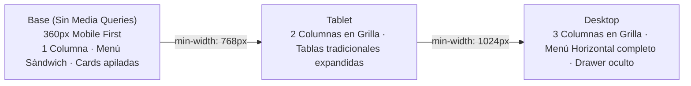

# UX-UI — Guía visual de estilos — Aprende-Gratis

> **Qué es:** la gramática visual y el sistema de diseño de la interfaz: tokens, componentes, estados
> y accesibilidad. Define las reglas con las que se construye cada pantalla antes de codificar CSS.
> **Inspiración:** Google Material Design 3 (estética limpia, espacio en blanco, azul primario `#1a73e8`,
> sombras sutiles, bordes redondeados y componentes con estados bien diferenciados).
> **Cuándo está bien:** dos desarrolladores que sigan esta guía maquetan la misma pantalla y obtienen
> exactamente el mismo resultado visual; todos los estados (focus, error, loading, empty) están cubiertos;
> la estrategia mobile-first con mejora progresiva es estricta y verificable.

---

## 1. Principios de diseño

1. **Claridad sobre adorno:** la interfaz no compite con el contenido formativo; cada elemento visual responde a una función o información concreta.
2. **Espacio en blanco como jerarquía:** el espaciado y los contrastes suaves agrupan y estructuran las secciones de forma natural sin sobrecargar con bordes pesados.
3. **Un solo color de acción principal:** el azul de Google (`#1a73e8`) guía la vista hacia la acción prioritaria de cada pantalla.
4. **Mobile-first genuino con mejora progresiva:** el CSS base se diseña y prueba para pantallas de 360px sin media queries. Solo se usan `@media (min-width: ...)` para aprovechar el mayor espacio de pantallas más anchas.
5. **Diseñar todos los estados:** la interfaz contempla de entrada el estado de carga (skeleton), el estado vacío (sin cursos encontrados) y el de error, no solo cuando la pantalla ya tiene datos.

---

## 2. Design tokens

### 2.1 Paleta de colores (Inspiración Google Material Design)

| Token | Valor HEX | Uso principal | Ratio de contraste WCAG AA |
|-------|-----------|---------------|----------------------------|
| `--color-primary` | `#1a73e8` | Botones primarios, enlaces activos, borde de foco, acentos | vs `#ffffff`: **4.6:1** ✓ (AA) |
| `--color-primary-dark` | `#185abc` | Hover y press de botones primarios | vs `#ffffff`: **5.8:1** ✓ (AA) |
| `--color-primary-container` | `#e8f0fe` | Fondos de chips seleccionados, ítem de menú activo | vs `#1a73e8`: **3.9:1** ✓ |
| `--color-on-primary` | `#ffffff` | Texto e iconos sobre fondos primarios | vs `#1a73e8`: **4.6:1** ✓ (AA) |
| `--color-surface` | `#ffffff` | Fondo de cards, modales, drawer y header | — |
| `--color-background` | `#f8f9fa` | Fondo global de la página (gris Google muy suave) | — |
| `--color-text` | `#202124` | Texto principal, títulos y etiquetas | vs `#ffffff`: **16.1:1** ✓ (AAA) |
| `--color-text-muted` | `#5f6368` | Metadatos secundarios, placeholders, fechas | vs `#ffffff`: **7.0:1** ✓ (AAA) |
| `--color-border` | `#dadce0` | Bordes de inputs, divisores de cards y tablas | vs `#ffffff`: **1.4:1** (bordes visuales) |
| `--color-border-focus` | `#1a73e8` | Borde al enfocar inputs interactivos | vs `#ffffff`: **4.6:1** ✓ |
| `--color-hover-grey` | `#f1f3f4` | Hover de botones secundarios y filas de tablas | — |
| `--color-success` | `#188038` | Toasts de éxito, badge de estado `Publicado` | vs `#ffffff`: **4.7:1** ✓ (AA) |
| `--color-success-bg` | `#e6f4ea` | Fondo de badge de éxito | — |
| `--color-warning` | `#b06000` | Badge de estado `En revisión`, advertencias | vs `#ffffff`: **4.8:1** ✓ (AA) |
| `--color-warning-bg` | `#fef7e0` | Fondo de badge de advertencia | — |
| `--color-error` | `#d93025` | Mensajes de error de validación, botón peligroso | vs `#ffffff`: **4.8:1** ✓ (AA) |
| `--color-error-bg` | `#fce8e6` | Fondo de alertas de error y badges `Rechazado` | — |

---

### 2.2 Tipografía

| Token | Familia | Tamaño / Line-height | Peso | Uso |
|-------|---------|----------------------|------|-----|
| `--font-family-base` | `'Roboto', -apple-system, BlinkMacSystemFont, 'Segoe UI', system-ui, sans-serif` | — | — | Tipografía base de toda la webapp |
| `--text-xs` | `'Roboto'` | `12px` / `16px` | Regular (400) | Badges compactos, pie de inputs |
| `--text-sm` | `'Roboto'` | `14px` / `20px` | Regular / Medium (500) | Metadatos de cards, tabla, textos de ayuda |
| `--text-base` | `'Roboto'` | `16px` / `24px` | Regular (400) | Cuerpo de párrafo, inputs, selects |
| `--text-lg` | `'Roboto'` | `18px` / `24px` | Medium (500) | Títulos de card de curso |
| `--text-xl` | `'Roboto'` | `22px` / `28px` | Bold (700) | Títulos de sección y modales |
| `--text-2xl` | `'Roboto'` | `28px` / `34px` | Bold (700) | Títulos principales de pantalla (Hero, Catálogo) |

---

### 2.3 Espaciado, bordes, sombras y capas

| Token | Valor | Uso |
|-------|-------|-----|
| `--space-1` | `4px` | Ajustes finos y espaciado de badges |
| `--space-2` | `8px` | Espacio entre iconos y texto, gaps compactos |
| `--space-3` | `12px` | Padding interno de inputs y botones |
| `--space-4` | `16px` | Padding estándar de cards, márgenes base en móvil |
| `--space-5` | `24px` | Separación entre bloques y secciones en móvil |
| `--space-6` | `32px` | Gaps de grillas en desktop |
| `--space-8` | `48px` | Separación de bloques mayores en desktop |
| `--radius-sm` | `4px` | Badges, chips pequeños |
| `--radius-input` | `8px` | Inputs, selects, textareas |
| `--radius-card` | `12px` | Tarjetas de curso, paneles contenedores |
| `--radius-button` | `20px` | Botones en estilo píldora Material 3 |
| `--shadow-card` | `0 1px 2px 0 rgba(60,64,67,0.3), 0 1px 3px 1px rgba(60,64,67,0.15)` | Elevación sutil para tarjetas en reposo |
| `--shadow-card-hover` | `0 1px 3px 0 rgba(60,64,67,0.3), 0 4px 8px 3px rgba(60,64,67,0.15)` | Elevación de cards al posar el cursor |
| `--shadow-modal` | `0 4px 8px 3px rgba(60,64,67,0.15), 0 8px 16px 4px rgba(60,64,67,0.1)` | Elevación para drawer lateral y modales |
| `--z-sticky` | `100` | Header fijo |
| `--z-drawer` | `200` | Menú sándwich mobile |
| `--z-modal` | `300` | Diálogos modales |
| `--z-toast` | `400` | Notificaciones flotantes globales |

---

### 2.4 Bloque CSS de Design Tokens (`src/estilos/tokens.css`)

```css
:root {
  /* Colores */
  --color-primary: #1a73e8;
  --color-primary-dark: #185abc;
  --color-primary-container: #e8f0fe;
  --color-on-primary: #ffffff;
  --color-surface: #ffffff;
  --color-background: #f8f9fa;
  --color-text: #202124;
  --color-text-muted: #5f6368;
  --color-border: #dadce0;
  --color-border-focus: #1a73e8;
  --color-hover-grey: #f1f3f4;
  --color-success: #188038;
  --color-success-bg: #e6f4ea;
  --color-warning: #b06000;
  --color-warning-bg: #fef7e0;
  --color-error: #d93025;
  --color-error-bg: #fce8e6;

  /* Tipografía */
  --font-family-base: 'Roboto', -apple-system, BlinkMacSystemFont, 'Segoe UI', system-ui, sans-serif;
  --text-xs: 0.75rem;    /* 12px */
  --text-sm: 0.875rem;   /* 14px */
  --text-base: 1rem;     /* 16px */
  --text-lg: 1.125rem;   /* 18px */
  --text-xl: 1.375rem;   /* 22px */
  --text-2xl: 1.75rem;   /* 28px */

  /* Espaciado */
  --space-1: 4px;
  --space-2: 8px;
  --space-3: 12px;
  --space-4: 16px;
  --space-5: 24px;
  --space-6: 32px;
  --space-8: 48px;

  /* Bordes y Sombras */
  --radius-sm: 4px;
  --radius-input: 8px;
  --radius-card: 12px;
  --radius-button: 20px;
  --shadow-card: 0 1px 2px 0 rgba(60,64,67,0.3), 0 1px 3px 1px rgba(60,64,67,0.15);
  --shadow-card-hover: 0 1px 3px 0 rgba(60,64,67,0.3), 0 4px 8px 3px rgba(60,64,67,0.15);
  --shadow-modal: 0 4px 8px 3px rgba(60,64,67,0.15), 0 8px 16px 4px rgba(60,64,67,0.1);

  /* Capas */
  --z-sticky: 100;
  --z-drawer: 200;
  --z-modal: 300;
  --z-toast: 400;
}
```

---

## 3. Estrategia mobile-first con mejora progresiva

> **Regla inquebrantable de la SPEC:** No se usan media queries para "reparar" o deshacer estilos en desktop.
> La base se escribe limpia para pantallas móviles de 360px. Luego, `@media (min-width: ...)` **únicamente agrega o expande** capacidades visuales.



| Nivel de pantalla | Media Query | Comportamiento del Layout |
|-------------------|-------------|---------------------------|
| **Mobile Base** (obligatorio) | **Ninguna (estilos base)** | - Layout vertical de 1 sola columna.<br>- Header con logo y botón hamburguesa (menú sándwich).<br>- Menú desplegado como Drawer lateral ocupando el 85% del ancho.<br>- Elementos interactivos con área táctil mínima de 44x44px.<br>- Tablas y listados representados como tarjetas verticales apiladas.<br>- Padding lateral de página de `16px` (`--space-4`). |
| **Tablet** | `@media (min-width: 768px)` | - Grilla de cursos pasa a 2 columnas (`grid-template-columns: repeat(2, 1fr)`).<br>- Listados como "Mis aportes" o "Validación" adoptan formato de tabla bidimensional.<br>- Padding lateral de página aumenta a `24px`. |
| **Desktop** | `@media (min-width: 1024px)` | - El botón hamburguesa se oculta (`display: none`).<br>- La navegación se muestra horizontal en el Header con accesos directos y avatar.<br>- La grilla del catálogo pasa a 3 columnas (`repeat(3, 1fr)`).<br>- Contenedor principal centrado con ancho máximo (`max-width: 1200px`). |

---

## 4. Componentes: anatomía, variantes y estados

### 4.1 Botones (`Boton.jsx`)

- **Anatomía:** Altura mínima 40px (área de toque accesible), padding horizontal `16px`, radio píldora `20px`, fuente `Roboto Medium (500)`.
- **Variantes:**
  - *Primario:* Fondo `--color-primary`, texto `--color-on-primary`, sin borde.
  - *Secundario:* Fondo transparente, borde `1px solid --color-border`, texto `--color-primary`.
  - *Peligro:* Fondo `--color-error`, texto blanco (para rechazos o borrados).
- **Estados obligatorios:**
  - `default`: Aspecto estándar.
  - `hover`: Oscurecimiento sutil (`--color-primary-dark` en primario, `--color-hover-grey` en secundario).
  - `focus-visible`: Anillo de foco de 2px sólido `--color-primary` separado 2px del botón (`outline-offset: 2px`).
  - `active`: Elevación reducida, escala visual `0.98`.
  - `disabled`: Fondo `#dadce0`, texto `#80868b`, cursor `not-allowed`, sin respuesta a eventos.
  - `loading`: Botón mantiene sus dimensiones exactas, texto transparente o reemplazado por un spinner circular SVG blanco.

---

### 4.2 Campos de formulario (`CampoTexto.jsx`, `Select.jsx`)

- **Anatomía:** Etiqueta (Label) siempre visible sobre el control (evita perder contexto), contenedor del input con borde `1px solid --color-border` y radio `8px`, texto de ayuda o mensaje de error debajo.
- **Estados obligatorios:**
  - `default`: Borde gris suave `--color-border`.
  - `focus`: Borde de 2px azul `--color-border-focus`, sombra de resplandor `0 0 0 1px #1a73e8`.
  - `error`: Borde de 2px rojo `--color-error`. Mensaje de error visible en rojo debajo del input, vinculado semánticamente mediante el atributo `aria-describedby="input-error"`.
  - `disabled`: Fondo `#f1f3f4`, cursor `not-allowed`.

---

### 4.3 Card de Curso (`CursoCard.jsx`)

- **Anatomía:**
  - Encabezado: Chip de categoría con fondo `--color-primary-container` y texto `--color-primary`.
  - Cuerpo: Título destacado en `--text-lg`, tema y docentes en `--text-sm` con color atenuado.
  - Badges de características (en fila con iconos):
    - "Certificado": Icono medalla (verde si aplica).
    - "Examen": Icono portapapeles.
    - "Avalado": Icono escudo institucional.
    - "Tomado por aportante": Badge distintivo (BR-002).
  - Pie: Botón secundario "Ver detalles" y botón rápido "Agregar a roadmap" (si está logueado).
- **Estados:**
  - `default`: Elevación `--shadow-card`.
  - `hover`: Elevación `--shadow-card-hover`, cursor pointer.
  - `en_roadmap`: Botón secundario cambia a badge "En tu roadmap" con tilde verde.

---

### 4.4 Menú sándwich (`Header.jsx` + `NavDrawer.jsx`)

- **Anatomía:**
  - Botón hamburguesa en Header: tamaño táctil 48x48px con 3 líneas horizontales SVG.
  - Drawer lateral: panel que desliza desde la izquierda ocupando el 85% de la pantalla (máximo 320px) con fondo blanco y elevación `--shadow-modal`.
  - Backdrop oscuro translúcido (`rgba(0,0,0,0.5)`) que cubre el resto de la pantalla.
- **Accesibilidad y comportamiento:**
  - Atributos del botón: `aria-expanded="true/false"`, `aria-controls="nav-drawer"`, `aria-label="Abrir menú de navegación"`.
  - Al abrir: se bloquea el scroll del fondo (`overflow: hidden` en body) y el foco salta al primer enlace o botón de cierre.
  - Cierre: al presionar la tecla `ESC`, al hacer clic en el backdrop exterior o al seleccionar cualquier enlace de navegación.

---

### 4.5 Paginador de consultas (`Paginador.jsx`)

- **Anatomía:** Contenedor centrado horizontalmente con botón "Anterior", indicador numérico de páginas (ej. `1`, `2`, `3...`) y botón "Siguiente".
- **Estados:**
  - Botón "Anterior" disabled si `page === 1`.
  - Botón "Siguiente" disabled si `page === total_paginas`.
  - Botón de página actual con fondo `--color-primary` y texto blanco (`aria-current="page"`).

---

### 4.6 Diálogo modal (`Modal.jsx`)

- **Anatomía:** Utilizado para la confirmación de rechazo con motivo (`/validar`) y confirmaciones críticas.
- **Comportamiento:**
  - Se monta sobre un portal de React con backdrop oscuro.
  - Implementa *focus trap* (el foco con tecla `Tab` no puede salir del modal mientras esté abierto).
  - Tecla `ESC` dispara el cierre sin ejecutar acciones.
  - Rol de accesibilidad: `role="dialog"` con `aria-modal="true"` y `aria-labelledby="modal-title"`.

---

### 4.7 Notificación Toast (`Toast.jsx`)

- **Anatomía:** Alerta flotante anclada al borde superior central con radio `8px`, sombra y botón de cierre rápido.
- **Variantes semánticas:**
  - `success`: Borde verde, fondo `--color-success-bg`, texto `--color-success`.
  - `error`: Borde rojo, fondo `--color-error-bg`, texto `--color-error`.
  - `warning`: Borde amarillo, fondo `--color-warning-bg`, texto `--color-warning`.
- **Accesibilidad:** `role="status"` y `aria-live="polite"` para que los lectores de pantalla anuncien el mensaje sin interrumpir bruscamente.
- **Duración:** Se auto-cierra tras 4 segundos; pausado al posar el cursor sobre él.

---

### 4.8 Skeleton Loader y Estados Vacíos (`Skeleton.jsx`, `EmptyState.jsx`)

- **Skeleton:** Bloques grises (`#e0e0e0`) con animación de pulso suave (`@keyframes pulse`) que replican la forma de las cards y tablas mientras se descargan datos de la API.
- **Empty State:** Bloque centrado con icono de gran tamaño en gris suave, título informativo en `--text-xl` ("No encontramos resultados para tu búsqueda") y un botón CTA sugerido ("Aportar un curso", "Explorar catálogo").

---

## 5. Accesibilidad WCAG 2.1 nivel AA (requisitos no negociables)

1. **Ratios de contraste comprobados:** Todo texto normal (`16px`) supera el ratio `4.5:1` sobre su fondo correspondiente. Los textos de gran tamaño (`>= 18px Bold` o `>= 24px`) superan el ratio `3:0:1`.
2. **Navegabilidad íntegra por teclado:** Toda función accesible con ratón puede ejecutarse con `Tab`, `Enter`, `Espacio` y `Flechas`.
3. **Indicador de foco visible:** Nunca se utiliza `outline: none` sin proveer un reemplazo `:focus-visible` de alto contraste (anillo de foco azul de 2px).
4. **Semántica de formularios:** Cada `<input>` y `<select>` cuenta con su `<label htmlFor="...">` asociado explícitamente.
5. **Respeto a preferencias del usuario:**
   ```css
   @media (prefers-reduced-motion: reduce) {
     * {
       animation-duration: 0.01ms !important;
       transition-duration: 0.01ms !important;
     }
   }
   ```

---

## 6. Iconografía

- **Librería adoptada:** `lucide-react` (iconos SVG limpios, modernos y livianos acordes a la estética Google).
- **Justificación:** Se integran directamente como componentes JSX de React; a diferencia de las fuentes tipográficas de iconos (icon fonts), no sufren demoras de carga por red, no provocan saltos de maquetación (FOIT) y permiten aplicar herencia de color nativa (`currentColor`).
- **Iconos principales:**
  - Menú hamburguesa: `Menu`, `X` (cerrar).
  - Estado de cursos: `Clock` (pendiente), `BookOpen` (en curso), `CheckCircle2` (completado).
  - Metadatos: `Award` (certificado), `FileCheck` (examen), `ShieldCheck` (aval), `ExternalLink` (enlace exterior).
  - Acciones: `Plus` (aportar/agregar), `Search` (buscar), `Trash2` (quitar), `ArrowUp`/`ArrowDown` (ordenar).
